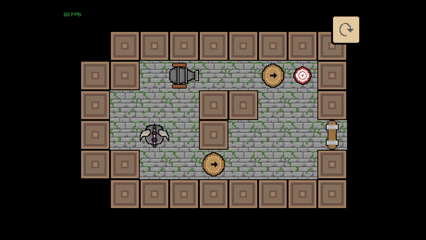
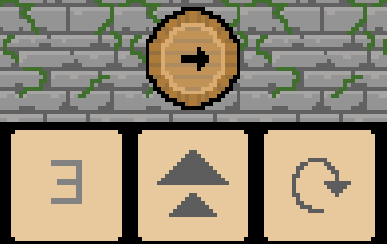
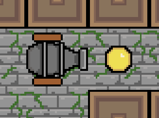
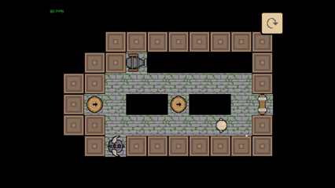
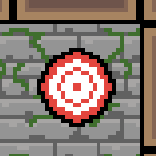
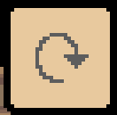
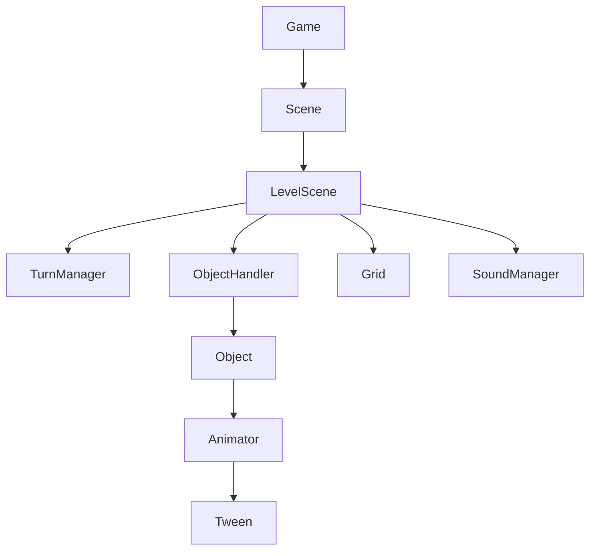
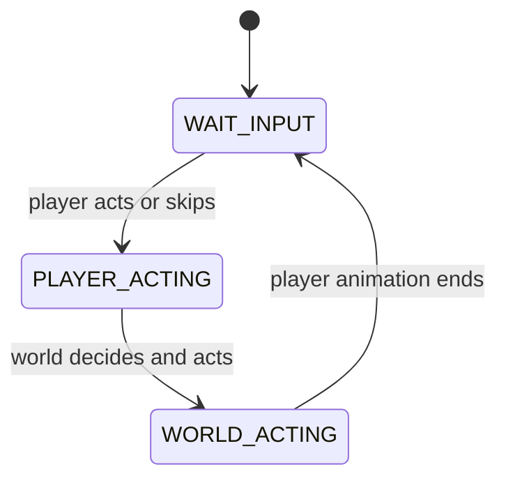

<div align="center">

# Skeleton To Nigromant

**A turn-based 2D puzzle game in C++20 and raylib, built around clean gameplay architecture.**




</div>

## About

Skeleton To Nigromant started as an [Unreal Engine 5 game](https://epicpantss.itch.io/skeleton-to-nigromant) (available on [itch.io]((https://epicpantss.itch.io/skeleton-to-nigromant))). This repository is a rewrite of it in 2D with **C++20 and raylib**, keeping the core mechanics and focusing on how the code is organized: turns, object interaction, animation and level loading.

You are a skeleton in a small dungeon. The world only moves when you do, so every step matters. Change the layout of the dungeon to your liking or make enemies fall on traps!

[](https://www.youtube.com/watch?v=-JVyYanbBE8)

## Gameplay

| | |
|---|---|
| <br>**Turn-based movement.** Enemies, cannons and bullets act only when the player does. | <br>**Interactive objects.** Click a cannon or crate to move or rotate it, with a limited number of moves. |
| <br>**Cannons.** They fire every few turns in the direction they face. Bullets hurt enemies and the player. | <br>**Enemy AI.** Enemies find the shortest path to the player with a bounded BFS. |
| <br>**Level goals.** Level 1: hit the target to open the door. Level 2: defeat the enemy. | <br>**Restart button.** Reset the level at any time. |

## Controls

| Input | Action |
|---|---|
| `W` `A` `S` `D` | Move (Use a turn) |
| `Right mouse button` | Skip a turn |
| `Left mouse button` on a cannon or crate | Open its menu to move or rotate it |
| Restart button (top right) | Restart the level |

## Features

- **Explicit turn system.** A small state machine (`WAIT_INPUT`, `PLAYER_ACTING`, `WORLD_ACTING`) decides who acts and when.
- **Reusable animation layer.** A `Tween` and `Animator` pair drives position, size and rotation independently, with easing curves (`OutQuad`, `OutBack`, linear) and per-animation end callbacks.
- **Event-driven objects.** Objects expose callbacks (`on_hit`, `on_move`, `on_die`, ...) that the level connects to sound, win conditions and doors, so the entity classes know nothing about audio or scenes.
- **Level data in text files.** One scene class runs every level. A level is a text file plus an entry in a table.
- **Bounded pathfinding.** BFS with a node cap and a checked reconstruction step.
- **Audio.** Music loop and sound effects through a small `SoundManager` that owns every sound to avoid loading multiple times the same file.
- **RAII everywhere.** Textures, sounds and objects are owned by `unique_ptr` or by classes that release them in their destructors.

## Build and run

Requirements: a C++20 compiler (MSVC, GCC or Clang), [CMake](https://cmake.org/) 3.20 or newer, and Git. raylib 6.0 is downloaded automatically the first time you configure the project.

```bash
git clone https://github.com/Public0Static1Void/SKN-Raylib.git
cd SKN-Raylib
cmake -S . -B build
cmake --build build --config Release
```

Then run the executable from the `build` folder (`build/Release/skn.exe` on Windows with Visual Studio). The `assets/` folder is copied next to it on every build.

With Visual Studio you can also use **File > Open > Folder** on the repository root and run the `skn` target.

## Levels

Levels live in `assets/levels/` as plain text. Lines starting with `#` are comments.

```
#SKN#Level1
111111111
100000cT1
1P0011001
100000001
1000c0001
111111111
```

| Char | Meaning |
|---|---|
| `1` | Wall |
| `0` | Floor |
| `H` | Hole |
| `P` | Player start |
| `E` | Enemy |
| `C` | Cannon |
| `c` | Crate |
| `T` | Target |
| `D` | Door |

To add a level, create the file and add an entry to `LEVELS_INFO` in `src/Levels.h` with its goal (`HIT_TARGET` or `KILL_ENEMIES`).

## Architecture



**Turn flow**



| Piece | Responsibility | File |
|---|---|---|
| `Game`, `Scene` | Window, audio device, main loop, scene switching | `src/Game.cpp`, `src/Scene.h` |
| `LevelScene` | Loads a level, spawns objects, connects events | `src/LevelScene.h` |
| `TurnManager` | Phases of a turn | `src/TurnManager.h` |
| `Object` and controllers | Shared entity data, life, actions, collisions | `src/Object.h`, `src/ObjectControllers.h`, `src/MovableObjects.h` |
| `ObjectHandler` | Owns objects, defers spawn and removal to the end of the frame | `src/ObjectHandler.cpp` |
| `Tween`, `Animator` | Independent per-property animation | `src/Tween.h`, `src/Animator.h` |
| `Grid`, `FindPathBFS` | Level data, walkability, pathfinding | `src/Grid.cpp`, `src/Pathfinding.cpp` |
| `SoundManager` | Loads and plays every sound by id | `src/SoundManager.h` |

### Design decisions

- **Callbacks instead of dependencies.** `Object` has no reference to audio or scenes. The level wires `on_hit` or `on_die` to what it needs, which keeps entities reusable.
- **Spawn and removal are deferred.** Objects created or killed during a frame are added or erased at the end of it, so loops over the object list stay valid.
- **Limits are explicit.** Maps are limited to 256x256 and a path search expands at most 2000 nodes. Exceeding them logs an error instead of freezing the game.

## Credits

Made by **Daniel González**. Built with [raylib](https://www.raylib.com/). Original game: [Skeleton To Nigromant on itch.io](https://epicpantss.itch.io/skeleton-to-nigromant).